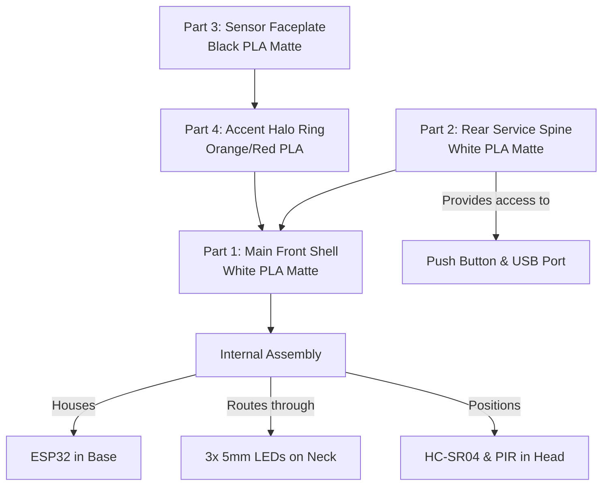

# Technical Design Specification: StudySense 3D Enclosure System

## 1. Executive Summary & Objective
This specification defines the mechanical design, dimensions, internal component cavity engineering, and multi-part 3D printing architecture for the **StudySense Smart Study Monitor**. The enclosure transforms the breadboard prototype into a consumer-grade, desktop IoT monitor matching the modern robotic aesthetic shown in user reference images.

The design is optimized specifically for **Bambu Studio** and Bambu Lab 3D printers (A1, P1S, X1C, H2S) on a Textured PEI Plate with zero visible external fasteners, tool-less snap-fit assembly, multi-filament color separation (White, Matte Black, Orange/Red), and optimized wire routing accommodating an 11 cm wire harness.

---

## 2. Component Dimensional Audit & Cavity Clearances

All internal cavities incorporate standard FDM 3D printing clearances (+0.4mm to +0.8mm) to ensure drop-in fit without post-print filing.

| Component | Physical Dimensions (W × H × D) | CAD Cavity Allowance | Retention Mechanism |
| :--- | :--- | :--- | :--- |
| **ESP32 DevKit** | 51.8 × 28.2 × 12.0 mm (with pins) | 54.0 × 30.5 × 14.0 mm | Horizontal base rails with snap-in retention clips |
| **HC-SR04 Ultrasonic** | PCB: 45.0 × 20.2 × 15.0 mm Transducers: 2× ⌀16.0 mm, 26.0 mm pitch | Faceplate cutouts: 2× ⌀16.4 mm Internal PCB pocket: 46.5 × 21.5 mm | Friction collar around transducer barrels + rear retention bracket |
| **PIR Motion Sensor** | PCB: 32.0 × 24.0 mm Fresnel Dome: ⌀23.0 mm | Faceplate aperture: ⌀23.6 mm PCB pocket: 33.5 × 25.5 mm | Perimeter locating bosses + dome pass-through |
| **Status LEDs (3x)** | ⌀5.0 mm dome, ⌀5.8 mm rim flange | 3× ⌀5.2 mm holes on front neck stem (pitch: 9.0 mm) | Push-through friction fit with internal shoulder stop |
| **Active Buzzer** | ⌀12.0 mm × 9.5 mm height | ⌀12.6 mm cavity in lower neck/head base | Internal friction pocket with acoustic port |
| **Tactile Push Button**| 6.0 × 6.0 mm base, 3.5 mm button stem | 6.5 × 6.5 mm rear recess with ⌀4.0 mm plunger hole | Press-fit mount in rear service spine |
| **USB Power Port** | Micro-USB / USB-C cable boot | 13.0 × 7.5 mm rear bottom slot | Cable strain relief slot flush with desk surface |

---

## 3. Wire Routing & Harness Constraints
* **Measured Wire Length:** The physical PIR motion sensor harness is measured at **110 mm (11 cm)** from the intermediate junction header to the sensor PCB.
* **Vertical Architecture:**
  - Base footprint height: 28 mm
  - Stem/Neck height: 105 mm
  - Head Pod center height: 155 mm
  - Internal wire channel cross-section: 18 mm × 14 mm (hollow internal conduit within neck).
  - Total wire run from base-mounted ESP32 headers up through neck to sensors: ~95 mm, leaving 15 mm of comfortable slack.

---

## 4. Multi-Part Modular Architecture

The model is partitioned into four discrete parts to allow clean printing without complex supports, independent filament color assignment in Bambu Studio, and seamless assembly:

### Part 1: Main Front Chassis (White PLA Matte)
* **Geometry:** Monolithic desktop structure integrating the weighted base foot, tapered neck column, and the rear cup of the circular head pod.
* **Front Branding:** Embossed StudySense logo on the angled front base ramp.
* **LED Status Cluster:** 3 precision 5.2 mm holes arranged vertically on the upper neck (Green = Study Active, Blue = Standby/Break, Red = Posture Warning / Absence Alert).
* **Head Cup:** 68.0 mm outer diameter, 62.0 mm inner diameter, with internal stepped collar to receive the Accent Halo and Faceplate.

### Part 2: Rear Service Spine & Cover (White PLA Matte)
* **Geometry:** Ergonomic back panel that follows the contour of the head, neck, and base rear.
* **Access Philosophy:** Removable at any time via 6 perimeter cantilever snap-fit tabs and alignment dowels.
* **Interfaces:**
  - Tactile button aperture and mounting bracket at ergonomic fingertip height on the rear spine.
  - Recessed rectangular opening at bottom rear for USB power cable insertion.

### Part 3: Sensor Faceplate (Black PLA Matte)
* **Geometry:** Circular disc (⌀60.0 mm × 2.5 mm thick).
* **Apertures:**
  - Top: ⌀23.6 mm aperture for the PIR Fresnel dome.
  - Bottom: Two ⌀16.4 mm circular apertures spaced 26.0 mm apart center-to-center for the HC-SR04 ultrasonic eyes.
  - Center: Micro acoustic / vent slot matching the reference design.
* **Mounting:** Snaps into the front head bezel with 3 internal locating keys ensuring perfect vertical sensor orientation.

### Part 4: Accent Halo Ring (Orange/Red PLA)
* **Geometry:** Precision concentric ring (Outer ⌀65.0 mm, Inner ⌀59.8 mm, Bevel radius 1.5 mm).
* **Function:** Provides the signature high-contrast boundary between the white outer head shell and the black sensor faceplate.
* **Printability:** Prints completely flat with zero supports.

---

## 5. Bambu Studio Slicing Specifications

* **Printer Profile:** Bambu Lab H2S / P1S / X1C / A1 with 0.20 mm or 0.40 mm Nozzle.
* **Build Plate:** Bambu Textured PEI Plate (256 × 256 mm).
* **Layer Settings:**
  - Layer Height: 0.16 mm Optimal (or 0.20 mm Standard).
  - First Layer Height: 0.20 mm.
  - Wall Loops: 3 (providing 1.2 mm solid shell strength).
  - Top Surface Pattern: Monotonic Line.
  - Infill: 15% Gyroid (ensures resonance damping for the active buzzer).
* **Support Strategy:**
  - Part 1 (Front Shell): Placed back-down or base-down with auto Tree Supports under head overhang.
  - Part 2 (Rear Spine): Placed flat on PEI plate, no supports required.
  - Part 3 (Faceplate): Placed flat face-down on Textured PEI plate for beautiful textured matte finish, zero supports.
  - Part 4 (Accent Ring): Placed flat, zero supports.

---

## 6. Verification & Quality Gates
1. **Geometric Manifoldness:** Every generated STL/3MF must have 0 non-manifold edges, 0 intersecting facets, and 100% watertight topology.
2. **CAD Interference Verification:** Boolean intersection test verifying zero collision between ESP32/HC-SR04/PIR PCB envelopes and internal housing walls.
3. **Bambu Studio Slicing Verification:** Execute `/Applications/BambuStudio.app` via CLI to slice the generated models, verify zero slicing errors, and export rendered plate verification images.
